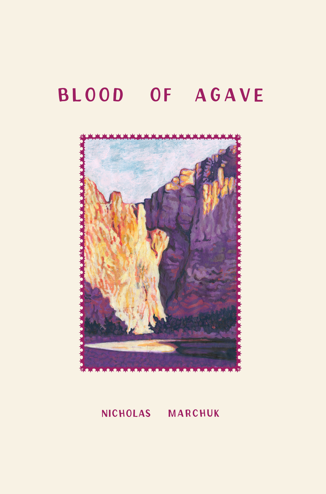

Hello! I'm so excited that the book is finally almost ready for you all to read. The book will be released on **December 31, 2026**, NYE.

---

[Ember Nevins](https://www.embernevinsart.com/) made the cover art. This, like the last one, is a mixed media collage. The making of the art was pretty involved and overall took a lot of work, and I'm really happy with how it turned out.

This cover is based on some photos my friends and I took while we were in Big Bend. This location is Boquillas canyon, and it does in fact feature heavily in the book. In real life, it's a beautiful but quiet place. In the book -- well, you'll have to read it and find out.

What's the book about? The book is the story of Brooklyn, a woman who gets lost in Big Bend National Park and winds up becoming an outlaw. This one is a major departure from the tone and content of the previous book. The protagonist is an influencer! This is not really "influencer fiction" or meant to mock that lifestyle -- it just happens to be her job. The more I wrote from Brooklyn's perspective, the more I started to root for her and want for her to figure things out. There's a lot she says, and a lot she doesn't say, which was really interesting to untangle.

The book is inspired foremost by a trip I took to Big Bend a couple years ago. I had never been out west before, and never really even been camping before, and managed to convince three of my friends to come to Texas with me to hang out in the desert for nine days. It was definitely more than trying at times, but well worth going. The whole place was so alien and beautiful that I feld like I needed to write about it.

The interior of the book also has art! Not as much as I wanted originally, but a few select chapters have pieces done by me and my friends. These will only be available in the print version.

For inspirations -- I think anyone who has read these books will find it obvious, but I find it interesting to discuss anyway -- I read *Blood Meridian* while writing the first draft. I think McCarthy is obviously not in the same league as me, I'm just some guy and he's quite a famous stylist, but when the news articles came out that he was kind of a loser I felt like that was a signal that I wasn't hurting anybody if I made some weak attempts to imitate him. I scaled this back pretty significantly in the later drafts, but I tried my hardest in this book to rely on similar methods of description to him. There are scenes in *Blood Meridian* that pass through a similar border region, which I was excited by when reading that book at the same time as writing this one.

Later scenes take heavy inspiration from *Wuthering Heights*. I picked the book up at a little free library and enjoyed it well enough, though it was a bit exhausting. If you read it you know what I mean. Lastly, someone who read my first book recommended I pick up *Less than Zero* by Bret Easton Ellis, which I thought was really good. From that, I was inspired to make a motif of italicized flashbacks that take on a different perspective and prose styling which, lately, are my favorite parts of the book to read. There is this kind of eternal headache-y separation from reality that Ellis imagines people from LA must experience, and I was excited to include that in my work as well.

## Local?

If you're local, I'm having a book release party, back at 72 Joy St. Somerville on Saturday, January 9th, at 7pm. Hope to see you there!

